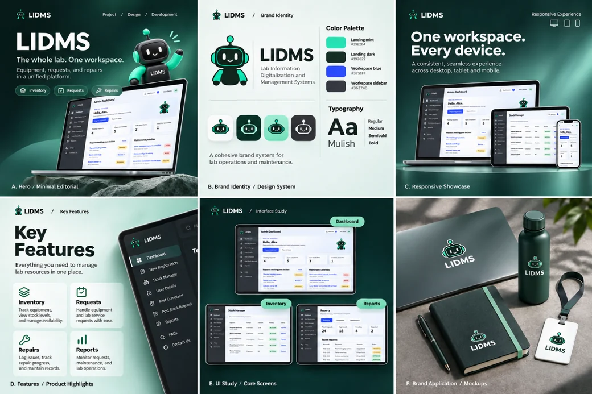

# LIDMS

## Project Overview

LIDMS (Lab Information Digitalization and Management Systems) manages laboratory equipment, stock requests, issued items, returns, and repairs. Administrators, faculty, and technicians use permission-aware workspaces, notifications, and reports to follow each operation.

## Project Preview



Application screens and visual identity. Branding mockups are presentation concepts.

## Key Features

- Equipment inventory, stock adjustments, and movement history.
- Equipment requests, approval decisions, issued items, and partial or complete returns.
- Complaint reporting, technician assignment, and repair tracking.
- Role-based dashboards, account administration, profiles, and notifications.
- Report filtering, CSV exports, and workspace transfer commands.

## Live Website & Related Repository

https://lidms.vercel.app/

## Tech Stack

- **Application:** Python, Django 5.2, Django templates, HTML, CSS, JavaScript.
- **Database:** PostgreSQL with psycopg; SQLite for local development.
- **Hosting and tools:** WhiteNoise, python-dotenv, Vercel configuration, Ruff, Playwright.

## Prerequisites

Python 3.12–3.14 as declared in `pyproject.toml`, pip, and PowerShell for the commands below. Python 3.14 is the configured development target. PostgreSQL is required for the hosted deployment.

## Installation & Setup

1. Open the repository root and create a virtual environment:

   ```powershell
   python -m venv .venv
   ```

2. Install dependencies:

   ```powershell
   .\.venv\Scripts\python.exe -m pip install -r requirements.txt
   ```

3. For a fresh setup, copy `.env.example` to `.env.local`. Generate a key and save it privately as `DJANGO_SECRET_KEY`:

   ```powershell
   .\.venv\Scripts\python.exe -c "from django.core.management.utils import get_random_secret_key; print(get_random_secret_key())"
   ```

4. Leave `DATABASE_URL` blank for SQLite. Select `.env.local` explicitly in the commands below: without `--env-file`, an existing `.env.neon` can connect to the shared hosted database.
5. On a new local database, create tables and an administrator:

   ```powershell
   .\.venv\Scripts\python.exe manage.py --env-file .env.local migrate
   ```

   ```powershell
   .\.venv\Scripts\python.exe manage.py --env-file .env.local createsuperuser
   ```

## Running Locally

Development at `http://127.0.0.1:8000/`:

```powershell
.\.venv\Scripts\python.exe manage.py --env-file .env.local runserver
```

Collect deployment static assets:

```powershell
.\.venv\Scripts\python.exe manage.py --env-file .env.local collectstatic --noinput
```

Production uses `lidms.wsgi:application`, with PostgreSQL, debug disabled, and private deployment settings. `runserver` is for development; no standalone production-start command is bundled.

Install check tools and run the test suite against a SQLite-configured local environment:

```powershell
.\.venv\Scripts\python.exe -m pip install -r requirements-dev.txt
```

```powershell
.\.venv\Scripts\python.exe manage.py --env-file .env.local test --noinput
```

## Project Structure

```text
inventory/            # Models, forms, workflows, permissions, and tests
lidms/                # Settings, environment loader, URLs, and WSGI
templates/            # Public pages and authenticated workspace
static/               # Styles, scripts, fonts, and images
tools/                # Browser verification tools
manage.py             # Management commands and environment selection
pyproject.toml        # Runtime requirements and lint configuration
vercel.json           # Django hosting configuration
```

## Acknowledgements & Credits

Mulish is distributed under the SIL Open Font License; its notice is included in `static/fonts/OFL.txt`.
